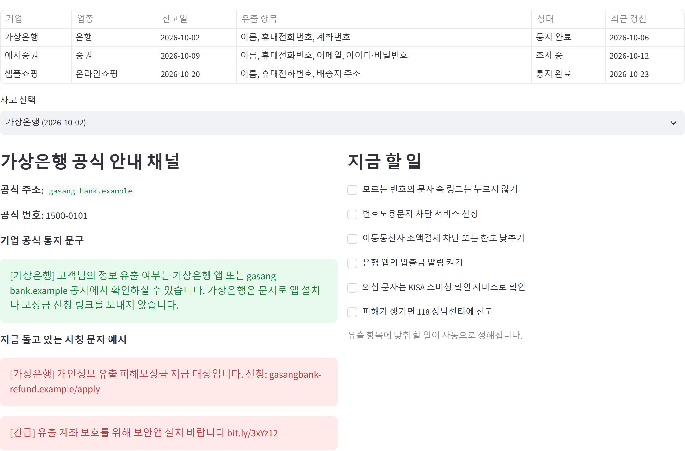
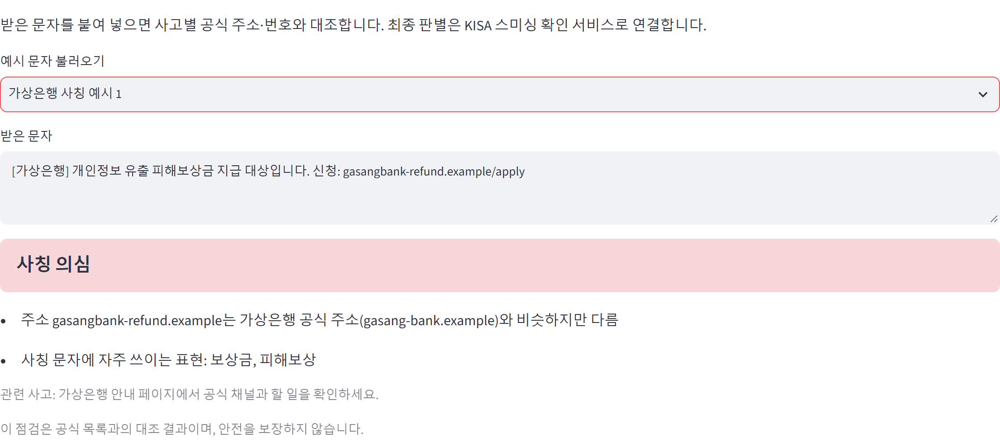
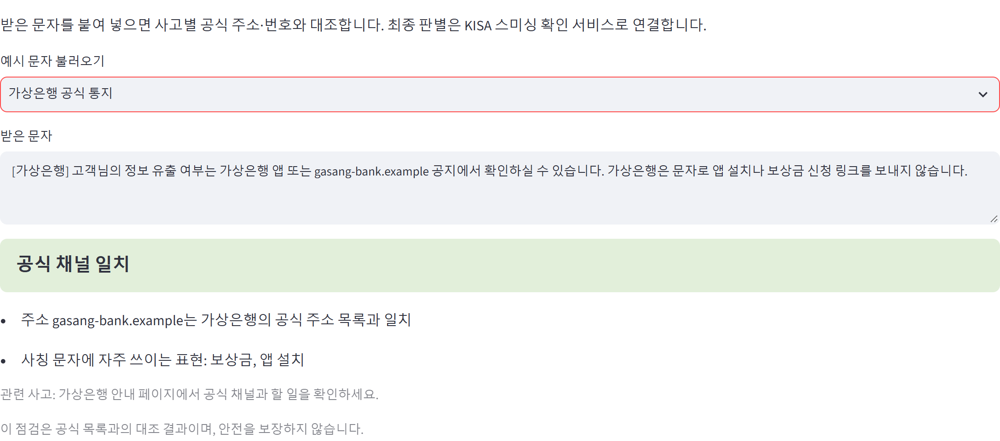

# 개인정보 유출 사고별 진짜 안내 확인 (시연용 시제품)

개인정보 유출 사고가 나면 사고별 공식 안내 채널과 할 일을 한곳에 모으고, 받은 문자가 공식 안내인지 사칭인지 대조해 주는 서비스의 시제품입니다. 「모두의 KISA」 국민참여예산 아이디어 제안의 작동 방식을 보여 주기 위해 만들었습니다. KISA 공식 서비스가 아닙니다.

## 화면
**사고별 안내 페이지:** 공식 주소·번호·통지 문구, 지금 돌고 있는 사칭 문자 예시, 유출 항목에 맞춘 할 일



**받은 문자 확인 (사칭 문자):** 공식 주소와 비슷하지만 다른 주소와 미끼 표현을 찾아 '사칭 의심'으로 표시



**받은 문자 확인 (기업 공식 통지):** 등록된 공식 주소와 일치하면 '공식 채널 일치'로 표시



## 무엇을 보여 주나
- **사고별 안내 페이지:** 기업이 등록한 공식 주소·번호·통지 문구, 지금 돌고 있는 사칭 문자 예시, 유출 항목에 맞춘 할 일 체크리스트
- **받은 문자 확인:** 문자 속 주소와 번호를 사고별 공식 목록과 대조해 "공식 채널 일치 / 사칭 의심 / 주의 / 판단 어려움"으로 표시. 공식 주소와 비슷한 주소, 단축 주소, 설치 파일 링크, 보상금·환불 같은 미끼 표현을 찾음
- **담당자 화면:** 기업이 공식 채널을 등록하면 안내 페이지와 메신저 알림 문안을 미리 보기

## 데이터
사고와 기업은 모두 가상이며, 주소는 예시용 예약 도메인(`.example`)만 씁니다. 실제 기업·번호와 관계없습니다.

## 실행
```bash
pip install -r requirements.txt
python -m unittest discover -s tests
streamlit run app.py
```

## 한계
- 문자 점검은 공식 목록과의 대조이며 안전을 보장하지 않습니다. 최종 판별은 기존 스미싱 확인 서비스와 연계하는 구조를 제안합니다.
- 실제 운영에는 유출 신고 단계에서 기업의 공식 채널을 받는 절차와 개인정보보호위원회와의 협업이 필요합니다.

## AI 활용 내역
코드 초안 작성에 AI 코딩 도구(Claude Code)를 보조로 썼습니다. 기능 설계, 규칙, 데이터 구성, 검증(단위 테스트 9개)은 제안자가 직접 확인했습니다.
